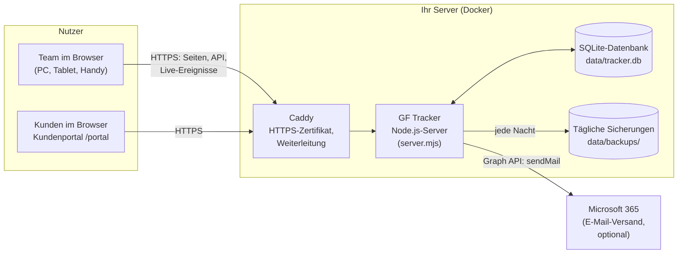
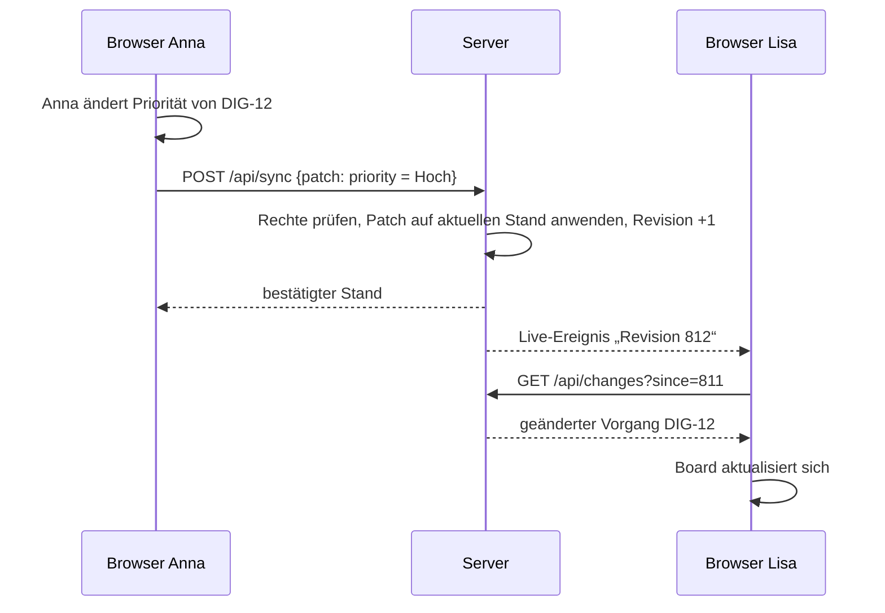

# GF Tracker – Architektur, Betrieb und Grundlagen

Dieses Dokument erklärt, **wie der GF Tracker aufgebaut ist**, **was man für den
Betrieb braucht** und **welche Begriffe** man kennen sollte. Es richtet sich an
die Geschäftsführung, die IT bzw. den IT-Dienstleister und an alle, die das
System einführen.

Inhalt

1. [Was ist der GF Tracker?](#1-was-ist-der-gf-tracker)
2. [Architektur auf einen Blick](#2-architektur-auf-einen-blick)
3. [Die Bausteine im Detail](#3-die-bausteine-im-detail)
4. [Wie Daten fließen – auch wenn mehrere gleichzeitig arbeiten](#4-wie-daten-fließen)
5. [Datenmodell und Rollen](#5-datenmodell-und-rollen)
6. [Sicherheit und Datenschutz](#6-sicherheit-und-datenschutz)
7. [Betrieb: Server, Installation, Updates, Sicherung](#7-betrieb)
8. [E-Mail über Microsoft 365 einrichten](#8-e-mail-über-microsoft-365-einrichten)
9. [Begriffe (Glossar)](#9-begriffe)
10. [Empfohlene Arbeitsweise](#10-empfohlene-arbeitsweise)
11. [Grenzen und mögliche Erweiterungen](#11-grenzen-und-mögliche-erweiterungen)
12. [Fehlerbehebung](#12-fehlerbehebung)
13. [Integration: als App, auf der Website und mit Ihren Programmen](#13-integration)

---

## 1. Was ist der GF Tracker?

Ein Ticketsystem nach dem Vorbild von **Jira** (Aufgaben und Projekte) und
**Jira Service Management** (Kundenanfragen), zugeschnitten auf ein
mittelständisches Unternehmen:

| Bereich | Was man damit macht |
| --- | --- |
| **Projekte & Aufgaben** | Arbeit als Vorgänge erfassen, zuweisen, priorisieren, mit Fristen versehen und über Boards verfolgen |
| **Scrum** (z. B. Digitalisierung) | Backlog pflegen, in Sprints planen, Fortschritt mit Burndown und Velocity messen |
| **Kanban** (z. B. Geschäftsführung, Verwaltung) | laufende Aufgaben ohne Sprints im Fluss abarbeiten |
| **Service-Desk** | Störungen, Wartungen und Kundenanfragen über ein **öffentliches Kundenportal** annehmen, mit **SLA-Fristen** bearbeiten und dem Kunden antworten |
| **Übersicht** | „Ihre Arbeit“, Dashboard, Berichte, Filter mit Abfragesprache (JQL), Benachrichtigungen in der App und per E-Mail |

Mehrere Personen arbeiten gleichzeitig; Änderungen erscheinen bei allen
**sofort (live)**, ohne die Seite neu zu laden.

---

## 2. Architektur auf einen Blick



**In einem Satz:** Ein kleiner Node.js-Server liefert die Web-Oberfläche aus,
speichert alles in einer SQLite-Datenbankdatei, verteilt Änderungen live an alle
geöffneten Browser und versendet bei Bedarf E-Mails über Microsoft 365. Davor
sitzt Caddy, der automatisch für ein gültiges HTTPS-Zertifikat sorgt.

**Warum so schlank?**

- **Keine externen Pakete:** Webserver, Datenbank (SQLite) und Verschlüsselung
  kommen direkt aus Node.js. Das heißt: keine Abhängigkeiten, die veralten oder
  Sicherheitslücken mitbringen, und Updates sind einfach.
- **Eine Datei als Datenbank:** Für ein Unternehmen mit bis zu einigen Dutzend
  Nutzern ist SQLite schnell, robust und wartungsfrei. Sicherung = Datei kopieren.
- **Ein Server, ein Container:** Läuft auf einem kleinen virtuellen Server, einem
  NAS mit Docker oder einem Server im Haus.

---

## 3. Die Bausteine im Detail

| Datei / Baustein | Aufgabe |
| --- | --- |
| `public/index.html`, `app.css`, `app.js` | **Browser-App** für das Team: alle Ansichten (Ihre Arbeit, Board, Backlog, Zeitleiste, Filter, Berichte, Warteschlangen, Einstellungen) |
| `public/shared.js` | **Gemeinsame Fachlogik** für Browser *und* Server: Vorgangstypen, Workflows, Prioritäten, SLA-Ziele, Beispieldaten und das Patch-Verfahren (siehe Abschnitt 4). Änderungen an Regeln nur hier. |
| `public/login.html`, `login.js` | Anmeldeseite |
| `public/portal.html`, `portal.js` | **Öffentliches Kundenportal** (ohne Anmeldung): Anfrage stellen, Stand verfolgen, antworten |
| `server.mjs` | **Server**: liefert Seiten aus, Schnittstellen (API), prüft Rechte, führt Änderungen zusammen, Live-Ereignisse, Hintergrundaufgaben (Fristen/SLA, E-Mails, Sicherungen) |
| `lib/store.mjs` | Datenbankzugriff (SQLite), Revisionszähler, Vorgangsnummern |
| `lib/auth.mjs` | Passwörter (scrypt), Sitzungen (Cookie), Schutz vor Passwort-Raten |
| `lib/mailer.mjs` | E-Mail-Versand über Microsoft Graph, E-Mail-Vorlage |
| `test/api.test.mjs` | Automatische Tests der wichtigsten Abläufe (`npm test`) |
| `Dockerfile`, `docker-compose.yml`, `Caddyfile` | Betrieb mit Docker inkl. HTTPS |
| `gf-tracker.service` | Alternative: Betrieb als Linux-Dienst ohne Docker |

### Hintergrundaufgaben des Servers

| Aufgabe | Wann | Was passiert |
| --- | --- | --- |
| Fristen & SLA prüfen | jede Minute | Benachrichtigung „Bald fällig“ (2 Tage vorher), „Überfällig“ (an Verantwortliche *und* Melder), „SLA gefährdet/verletzt“ im Service-Desk – jede Meldung **genau einmal** |
| E-Mail-Benachrichtigungen | jede Minute | Ungelesene Benachrichtigungen der letzten 24 h werden je Person gebündelt per E-Mail verschickt (abschaltbar je Person) |
| Kunden-E-Mails | sofort | Eingangsbestätigung, neue Antwort des Service, „Anfrage gelöst“ – jeweils mit persönlichem Link |
| Sicherung | täglich | Kopie der Datenbank nach `data/backups/tracker-JJJJ-MM-TT.db`; die letzten 14 bleiben erhalten |

---

## 4. Wie Daten fließen

### Laden

Nach der Anmeldung lädt der Browser einmal den kompletten Datenstand
(`GET /api/state`) und hält ihn im Arbeitsspeicher. Deshalb sind Board, Filter
und Berichte sehr schnell – auch die Abfragesprache läuft direkt im Browser.

### Ändern: nur Unterschiede werden gesendet



- Jede Änderung wird als **Patch** übertragen – also nur *was* sich geändert hat
  („Priorität = Hoch“, „Kommentar hinzugefügt“), nicht der ganze Vorgang.
- Der Server wendet den Patch auf den **aktuellen** Stand an. Ändern zwei
  Personen gleichzeitig **verschiedene Felder** oder schreiben beide einen
  **Kommentar**, bleibt beides erhalten. Ändern beide **dasselbe Feld**, gilt die
  zuletzt gespeicherte Änderung.
- Über **Server-Sent Events** (`/api/events`) erfahren alle geöffneten Browser,
  dass es Neues gibt, und holen nur die Änderungen seit ihrem letzten Stand.
- **Vorgangsnummern** (z. B. SD-17) vergibt ausschließlich der Server, damit
  auch bei gleichzeitigem Anlegen keine Nummer doppelt vorkommt.

### Verbindung weg?

Bricht die Verbindung ab, zeigt die App „Offline – Änderungen werden
nachgereicht“. Die Änderungen bleiben im Browser vorgemerkt und werden
automatisch übertragen, sobald die Verbindung wieder steht. Beim Schließen des
Tabs wird ein letzter Versand versucht. (Ein vollständiger Offline-Betrieb über
Tage ist nicht vorgesehen.)

### Wichtige Schnittstellen (API)

| Methode & Pfad | Zweck |
| --- | --- |
| `POST /api/login`, `POST /api/logout` | An-/Abmelden |
| `GET /api/me`, `POST /api/me/password` | Eigenes Profil, Passwort ändern |
| `GET /api/state` | Gesamter Datenstand (nur eigene Benachrichtigungen) |
| `GET /api/changes?since=N` | Änderungen seit Revision N |
| `POST /api/sync` | Änderungen speichern (Patches) |
| `POST /api/projects/:id/reserve` | Nächste freie Vorgangsnummer |
| `GET /api/events` | Live-Ereignisse |
| `POST /api/admin/users`, `…/users/:id/password` | Personen anlegen, Passwort setzen (Admin) |
| `GET /api/admin/export`, `POST /api/admin/import` | Sicherung herunterladen/einspielen (Admin) |
| `GET /api/portal/config`, `POST /api/portal/requests` | Kundenportal: Formular, Anfrage stellen |
| `GET/POST /api/portal/requests/:token[/comments]` | Kundenportal: Stand ansehen, antworten |
| `GET /api/health` | Statusprüfung für Überwachung |

---

## 5. Datenmodell und Rollen

Alle fachlichen Objekte liegen als JSON in der Tabelle `entities`; jede Änderung
erhält eine fortlaufende Revisionsnummer.

| Objekt | Wichtige Felder |
| --- | --- |
| **Person** (`users`) | Name, E-Mail, Rolle, aktiv, E-Mail-Benachrichtigungen ja/nein |
| **Team** (`teams`) | Name, Farbe, Teamleitung, Mitglieder, Aufgabe – eine Person kann in mehreren Teams sein |
| **Projekt** (`projects`) | Schlüssel (z. B. SD), Name, Vorlage (Scrum/Kanban/Service-Desk), Projektleitung, Standard-Team |
| **Vorgang** (`issues`) | Typ, Zusammenfassung, Beschreibung, Status, Priorität, Team, verantwortlich, Melder, Labels, Fälligkeit, Story Points, Epic, übergeordneter Vorgang, Sprint, Verknüpfungen, Beobachter, Kommentare (auch intern), Verlauf, Zeiterfassung; im Service-Desk zusätzlich Kunde und SLA-Zeitpunkte |
| **Sprint** (`sprints`) | Name, Ziel, Zeitraum, Zustand (geplant/aktiv/abgeschlossen), zugesagte/erledigte Story Points |
| **Filter** (`filters`) | Name, JQL-Abfrage |
| **Benachrichtigung** (`notifications`) | Empfänger, Art, Text, Bezug, gelesen |

Getrennt davon (nie an Browser ausgeliefert): `accounts` (Passwort-Hashes),
`sessions` (Sitzungen), `portal_tokens` (Kunden-Links), `counters`
(Vorgangsnummern), `mail_log` (bereits gemailte Benachrichtigungen).

**Rollen**

| Rolle | Darf |
| --- | --- |
| **Administrator** | alles, zusätzlich Personen anlegen/deaktivieren, Passwörter setzen, Projekte anlegen/ändern/löschen, Sicherungen herunterladen/einspielen |
| **Mitglied** | in allen Projekten Vorgänge, Sprints und Filter anlegen und bearbeiten; eigenen Namen, eigenes Passwort und E-Mail-Benachrichtigungen ändern |
| **Service-Mitarbeiter** | wie Mitglied; wird zusätzlich über jede neue Kundenanfrage benachrichtigt |
| **Kunde** (ohne Konto) | über das Portal Anfragen stellen und – nur mit seinem persönlichen Link – den Stand sehen und antworten; sieht keine internen Notizen |

---

## 6. Sicherheit und Datenschutz

| Thema | Umsetzung |
| --- | --- |
| Transport | Ausschließlich **HTTPS** (Caddy, automatisches Let's-Encrypt-Zertifikat); HSTS aktiv |
| Passwörter | Mindestens 10 Zeichen, gespeichert nur als **scrypt-Hash** mit Salt; nach 10 Fehlversuchen 15 Minuten Sperre je IP+E-Mail |
| Sitzungen | Zufälliges Token im **HttpOnly-, Secure-, SameSite-Cookie**; in der Datenbank nur als SHA-256-Hash; 14 Tage gültig; Passwortänderung beendet andere Sitzungen; Deaktivieren sperrt sofort |
| Angriffe aus dem Browser | **CSRF-Schutz** (Pflicht-Header bei jeder Änderung), strenge **Content-Security-Policy** (kein fremdes Skript), Schutz gegen Einbetten (Clickjacking), alle Ausgaben werden maskiert (XSS) |
| Rechte | Werden **auf dem Server** geprüft, nicht nur in der Oberfläche |
| Kundenportal | Kein Zugriff auf interne Daten; Kunden sehen nur ihre eigene Anfrage über einen **nicht erratbaren Link** (24 Byte Zufall); Spam-Schutz (Honeypot, Mengenbegrenzung je IP) |
| Datenhaltung | Alle Daten auf **Ihrem** Server; E-Mails gehen nur über Ihr Microsoft 365 |

**Datenschutz (DSGVO) – was Sie organisatorisch tun sollten**

- Server in Deutschland/EU betreiben; mit dem Hoster einen
  **Auftragsverarbeitungsvertrag (AVV)** schließen.
- Im Kundenportal ist ein Hinweis zur Datenverwendung enthalten; verlinken Sie
  zusätzlich Ihre **Datenschutzerklärung** (z. B. im Impressum Ihrer Website).
- Den Tracker im **Verzeichnis der Verarbeitungstätigkeiten** aufnehmen.
- **Löschkonzept** festlegen, z. B. erledigte Kundenanfragen nach X Jahren
  löschen (derzeit manuell über „Vorgang löschen“).
- Zugriff auf Server und Sicherungen auf wenige Personen beschränken.

---

## 7. Betrieb

### Was wird gebraucht?

| Bestandteil | Empfehlung |
| --- | --- |
| Server | Linux-Server mit Docker: **1 vCPU, 1 GB RAM, 10 GB Speicher** reichen für 50 Nutzer. Beispiele: virtueller Server bei einem deutschen Hoster (ca. 5–10 € im Monat), Server im Haus, Synology/QNAP-NAS mit Docker |
| Domain | z. B. `tracker.ihre-firma.de` – ein DNS-Eintrag (A-Record) auf die IP des Servers |
| Erreichbarkeit | Ports 80 und 443 aus dem Internet erreichbar (nötig für das Zertifikat und das **Kundenportal**). Soll nur das Team zugreifen, genügt ein Server im Firmennetz/VPN – das Kundenportal ist dann aber für Kunden nicht erreichbar |
| Optional | Microsoft 365 für E-Mails (Abschnitt 8) |

### Installation mit Docker (empfohlen)

```bash
# 1. Code auf den Server holen (Ordner "tracker" aus dem Repository)
git clone <repository-url> && cd <repository>/tracker

# 2. Konfiguration anlegen und anpassen (Domain, Firmenname, Admin-E-Mail …)
cp .env.example .env
nano .env

# 3. Datenordner anlegen (gehört dem Benutzer 1000 = "node" im Container)
mkdir -p data && sudo chown 1000:1000 data

# 4. Starten
docker compose up -d --build

# 5. Startpasswort des Administrators aus dem Log lesen (falls ADMIN_PASSWORD leer)
docker compose logs tracker | grep Startpasswort
```

Danach `https://tracker.ihre-firma.de` öffnen, als Administrator anmelden,
**Passwort ändern** (Einstellungen), Personen anlegen und Projekte erstellen.

**Ausprobieren ohne Server** (lokal mit Beispieldaten, Node.js ≥ 22.13):

```bash
cd tracker
npm run demo     # http://localhost:3000 – z. B. thomas.weber@druckluft-chemnitz.de / Passwort123!
npm test         # automatische Tests
```

### Konfiguration (`.env`)

| Variable | Bedeutung |
| --- | --- |
| `APP_URL` | Öffentliche Adresse, z. B. `https://tracker.ihre-firma.de` (für Links in E-Mails; `https://` schaltet sichere Cookies ein) |
| `DOMAIN` | Domain für das HTTPS-Zertifikat |
| `COMPANY_NAME` | Name im Kundenportal und in E-Mails |
| `ADMIN_EMAIL`, `ADMIN_NAME`, `ADMIN_PASSWORD` | Administrator; wird beim Start angelegt, falls diese E-Mail noch keinen Zugang hat |
| `MS_TENANT_ID`, `MS_CLIENT_ID`, `MS_CLIENT_SECRET`, `MAIL_SENDER` | E-Mail über Microsoft 365 (optional) |
| `BACKUP_KEEP` | Anzahl aufbewahrter Tagessicherungen (Standard 14) |
| `PORTAL_FRAME_ANCESTORS` | Website(s), die das Kundenportal einbetten dürfen, z. B. `https://www.ihre-firma.de` |
| `SEED_DEMO` | `1` = Beispieldaten beim ersten Start (nur zum Testen) |
| `DATA_DIR`, `PORT`, `HOST`, `TRUST_PROXY`, `COOKIE_SECURE` | Technische Feineinstellungen; in Docker vorbelegt |

### Daten aus der Einzel-HTML-Version übernehmen

In der Einzel-HTML-Datei unter *Einstellungen → Sicherung speichern* eine
JSON-Datei erzeugen und im Server unter *Einstellungen → Sicherung einspielen*
hochladen (ersetzt alle Projekte und Vorgänge). Personen ohne Passwort erhalten
anschließend über „Passwort“ in der Personenliste ein Startpasswort.

### Updates

```bash
cd tracker && git pull && docker compose up -d --build
```

Die Datenbank bleibt im Ordner `data/` erhalten. Vor größeren Updates eine
Sicherung herunterladen.

### Sicherung und Wiederherstellung

- **Automatisch:** jede Nacht eine Kopie in `data/backups/` (14 Tage).
- **Wichtig:** Den Ordner `data/backups/` zusätzlich **außerhalb des Servers**
  sichern (z. B. nächtlich per `rsync`/Backup-Software auf NAS oder Cloud-Speicher)
  – sonst ist bei einem Serverausfall auch die Sicherung weg.
- **Manuell:** *Einstellungen → Sicherung herunterladen* (JSON, ohne Passwörter).
- **Wiederherstellen einer Tagessicherung:**

```bash
docker compose stop tracker
cp data/backups/tracker-2026-10-15.db data/tracker.db
rm -f data/tracker.db-wal data/tracker.db-shm
docker compose start tracker
```

Testen Sie die Wiederherstellung einmal, bevor Sie sich darauf verlassen.

### Überwachung

- `https://tracker.ihre-firma.de/api/health` liefert `{"ok":true,…}` – eignet
  sich für einen Uptime-Monitor (z. B. Uptime Kuma oder den Monitor Ihres
  Hosters).
- Protokolle: `docker compose logs -f tracker` (Anmeldungen, angelegte
  Personen, E-Mail-Versand, Sicherungen, Fehler).

---

## 8. E-Mail über Microsoft 365 einrichten

Der Tracker verschickt E-Mails im Namen eines **zentralen Postfachs**, z. B.
`service@ihre-firma.de`. Dafür wird eine App-Registrierung in Microsoft Entra
ID benötigt (einmalig, durch einen Microsoft-365-Administrator):

1. [Microsoft Entra Admin Center](https://entra.microsoft.com) →
   *Anwendungen → App-Registrierungen → Neue Registrierung*, Name
   „GF Tracker“, nur Konten dieses Verzeichnisses.
2. *Zertifikate & Geheimnisse → Neuer geheimer Clientschlüssel* → Wert kopieren
   → `MS_CLIENT_SECRET`. **Ablaufdatum notieren** und rechtzeitig erneuern!
3. *Übersicht*: Anwendungs-ID → `MS_CLIENT_ID`, Verzeichnis-ID →
   `MS_TENANT_ID`.
4. *API-Berechtigungen → Berechtigung hinzufügen → Microsoft Graph →
   **Anwendungsberechtigungen** → `Mail.Send`* → **Administratorzustimmung
   erteilen**.
5. Empfohlen: Die App per Exchange-Online-PowerShell auf das eine Postfach
   beschränken, damit sie nicht im Namen beliebiger Postfächer senden kann:
   ```powershell
   New-ApplicationAccessPolicy -AppId <MS_CLIENT_ID> -PolicyScopeGroupId service@ihre-firma.de -AccessRight RestrictAccess -Description "GF Tracker nur Service-Postfach"
   ```
6. `MAIL_SENDER=service@ihre-firma.de` in `.env` eintragen, neu starten
   (`docker compose up -d`) und unter *Einstellungen → Test-E-Mail an mich
   senden* prüfen.

Ohne diese Einrichtung funktioniert alles andere unverändert; Benachrichtigungen
erscheinen dann nur in der App, und Kunden sehen nach dem Absenden ihren
persönlichen Link direkt im Browser.

---

## 9. Begriffe

| Begriff | Bedeutung |
| --- | --- |
| **Projekt** | Ein Arbeitsbereich mit eigenem Kürzel (z. B. `SD`), eigenem Board und eigenen Vorgängen |
| **Vorgang** (engl. *Issue*, umgangssprachlich *Ticket*) | Eine Arbeitseinheit, z. B. Aufgabe, Störung, Story. Hat einen **Schlüssel** wie `SD-17` |
| **Vorgangstyp** | Epic, Story, Aufgabe, Bug, Teilaufgabe – im Service-Desk Störung, Wartung, Serviceanfrage |
| **Epic** | Großes Vorhaben, das viele Vorgänge bündelt (z. B. „Kundenportal“); erscheint in der **Zeitleiste** |
| **Story** | Eine Anforderung aus Nutzersicht („Als Kunde möchte ich …“) |
| **Teilaufgabe** | Kleiner Schritt innerhalb eines Vorgangs |
| **Status / Workflow** | Bearbeitungsstand, z. B. *Zu erledigen → In Arbeit → In Prüfung → Fertig*. Jeder Status gehört zu einer **Kategorie** (grau = offen, blau = in Arbeit, grün = erledigt) |
| **Priorität** | Höchste, Hoch, Mittel, Niedrig, Niedrigste |
| **Verantwortlich / Melder** | Wer den Vorgang bearbeitet / wer ihn gemeldet hat |
| **Beobachter** | Personen, die über Änderungen informiert werden |
| **Board** | Spalten je Status, Karten per Ziehen verschieben (Kanban-Tafel) |
| **Backlog** | Liste aller noch nicht eingeplanten Vorgänge, nach Wichtigkeit sortiert |
| **Sprint** | Fester Zeitraum (meist 2 Wochen), in dem ein Team eine Auswahl aus dem Backlog erledigt |
| **Story Points** | Relative Aufwandsschätzung (1, 2, 3, 5, 8, 13 …), keine Stunden |
| **Velocity** | Erledigte Story Points je Sprint – Grundlage für realistische Planung |
| **Burndown** | Diagramm der verbleibenden Story Points im laufenden Sprint |
| **Kanban** | Arbeiten ohne Sprints: Aufgaben fließen kontinuierlich über das Board |
| **Service-Desk** | Projekt für Kundenanfragen mit Kundenportal, Warteschlangen und SLA |
| **SLA** (Service Level Agreement) | Zugesagte Reaktions-/Lösungszeit, z. B. bei „Anlage steht“ erste Antwort in 1 h, Lösung in 4 h. „Wartet auf Kunde“ hält die Lösungsuhr an |
| **Warteschlange** | Gefilterte Liste im Service-Desk, z. B. „Nicht zugewiesen“ oder „SLA gefährdet“ |
| **Interne Notiz** | Kommentar, den Kunden im Portal nicht sehen |
| **JQL** | Abfragesprache für Filter, z. B. `assignee = currentUser() AND resolution = Unresolved ORDER BY due ASC` |
| **Label** | Freies Schlagwort zum Gruppieren (z. B. `vor-ort`, `portal`) |

**SLA-Ziele (anpassbar in `public/shared.js`)**

| Priorität (Kunde wählt „Dringlichkeit“) | Erste Antwort | Lösung |
| --- | --- | --- |
| Höchste („Anlage steht – Produktion betroffen“) | 1 h | 4 h |
| Hoch („Eingeschränkter Betrieb“) | 4 h | 1 Tag |
| Mittel („Normal“) | 8 h | 3 Tage |
| Niedrig („Nicht dringend“) | 24 h | 5 Tage |
| Niedrigste | 48 h | 10 Tage |

Die Zeiten laufen derzeit in **Kalenderzeit** (auch nachts/am Wochenende).

---

## 10. Empfohlene Arbeitsweise

**Projekte für den Start**

| Projekt | Vorlage | Wofür |
| --- | --- | --- |
| `GF` Geschäftsführung | Kanban | Vorhaben und Aufgaben der Geschäftsführung, Verwaltung |
| `SD` Service-Desk | Service-Desk | Störungen, Wartungen, Kundenanfragen – Portal-Link auf Website und in E-Mail-Signaturen |
| `DIG` Digitalisierung | Scrum | IT- und Digitalisierungsprojekte mit Sprints |

**Der Arbeitsablauf im System**

Jeder Vorgang zeigt rechts den Kasten **„Arbeitsablauf“**: oben eine
Fortschrittsleiste, darunter der *nächste sinnvolle Schritt* als blaue
Schaltfläche und die Alternativen. Ein Schritt fragt genau die Angaben ab, die
für ihn nötig sind – ohne sie geht es nicht weiter. Der Statuswechsel per
Board-Drag oder „Status direkt setzen“ bleibt als Ausnahme möglich.

Service-Desk (Störung, Wartung, Anfrage):

| Status | Nächster Schritt | Pflichtangaben | Kunde erhält |
| --- | --- | --- | --- |
| Neu | Übernehmen → **Einplanen** (Störung/Wartung) bzw. **Bearbeiten** (Anfrage) | Techniker, Datum, Uhrzeit | Terminbestätigung per Mail + im Portal |
| Eingeplant | **Einsatz beginnen** · Termin verschieben · Rückfrage | – / neuer Termin / Nachricht | bei Verschiebung neue Terminmail |
| In Arbeit | **Erledigt – Servicebericht** · Ersatzteil bestellt · Rückfrage | Durchgeführte Arbeiten (+ Ursache, Material, Stunden) / interne Notiz / Nachricht | Servicebericht per Mail + im Portal |
| Wartet auf Kunde / Ersatzteil | **Fortsetzen** oder neu einplanen | – / Termin | – |
| Erledigt | **Abschließen** (oder Wiedereröffnen) | – | – |

Interne Projekte: *Zu erledigen → In Arbeit → Prüfung → Fertig*, mit
„Blockiert“ (Grund ist Pflicht). Bei „Zur Prüfung“ wird der Melder
benachrichtigt und findet den Vorgang unter „Zur Freigabe durch Sie“;
„Nacharbeit“ verlangt eine Begründung.

- **Mein Tag** („Ihre Arbeit“): Sofort erledigen (überfällig, SLA gefährdet,
  verpasste Termine), Neue Kundenanfragen, Heute, In Arbeit, Wartet,
  Zur Freigabe – jede Zeile mit ihrer nächsten Schaltfläche.
- **Einsatzplanung** (Service-Desk): Wochenraster Techniker × Tag. Offene
  Vorgänge links auf eine Zelle ziehen = einplanen; Karten verschieben =
  Termin ändern (Uhrzeit bleibt, Kunde wird informiert).
- **Servicebericht**: entsteht beim Schritt „Erledigt“, ist im Vorgang
  druckbar (PDF über den Browser) und für den Kunden im Portal sichtbar;
  die Stunden fließen in die Zeiterfassung.
- **Erinnerungen**: Der Techniker wird am Vortag/morgens an seinen Termin
  erinnert; ist ein Einsatz 2 Stunden nach Termin nicht begonnen, erscheint
  er unter „Sofort erledigen“ und es gibt eine Benachrichtigung.

**Teams – wer stimmt sich mit wem ab**

Personen werden in Teams eingeteilt (Beispiel: Geschäftsführung, Service & Technik,
Büro & Vertrieb, Digitalisierung). Teams legen Administratoren an (Einstellungen
oder Menü „Teams“); die Teamleitung kann Mitglieder und Aufgabe selbst pflegen.

- Jeder Vorgang kann einem **Team** zugeordnet sein; jedes Projekt hat ein
  **Standard-Team**, in dem neue Vorgänge und Kundenanfragen automatisch landen.
- **Team-Eingang:** Vorgänge mit Team, aber ohne verantwortliche Person. Alle
  Mitglieder werden benachrichtigt und sehen sie unter „Mein Tag“, bis jemand
  „Übernehmen“ klickt oder die Teamleitung sie per Auswahl verteilt.
- **Teamseite:** Kennzahlen, Team-Eingang, „Wer macht was?“ (eine Spalte je
  Person mit allen offenen Vorgängen, sortiert nach Dringlichkeit – Karten per
  Ziehen an eine andere Person übergeben), Termine &amp; Fristen der nächsten
  7 Tage und die letzten Aktivitäten. Ideal für eine kurze tägliche Abstimmung.
- In der Einsatzplanung lässt sich nach Team filtern, in der Suche mit
  `team = "Service & Technik"`, und die Excel-Auswertung enthält ein Blatt „Teams“.

**Excel-Auswertung**

Dashboard, Projektberichte, Teamseiten, die Filtersuche und die Einstellungen
bieten „Excel-Auswertung“: eine echte .xlsx-Datei mit den Blättern Übersicht,
Vorgänge, Serviceeinsätze, Teams, Personen, Monate, Statusverlauf und
Kommentare – mit Filter in der Kopfzeile und echten Datums-/Zahlenwerten, also
direkt für Pivot-Tabellen und Diagramme nutzbar. Die Filtersuche exportiert genau
das aktuelle Suchergebnis.

Vor dem Export wird der **Zeitraum** gewählt: gesamter Zeitraum, aktuelles
Quartal, Vorquartal, frühere Quartale oder ein Jahr. Ein Quartal enthält alle
Vorgänge, die darin erstellt, bearbeitet oder erledigt wurden. Das Blatt
**Dashboard** zeigt Kennzahlen (bei abgeschlossenen Quartalen „offen“ und
„überfällig“ zum Stichtag, sonst mit Vergleich zum Vorquartal), native
Excel-Diagramme – Wochenverlauf, Quartalsvergleich erstellt/erledigt, Ø
Durchlaufzeit je Quartal, Status, Arbeitslast, Teams, Priorität, Top-Kunden –
sowie die Listen „Überfällig“ und „Nächste Termine“. Das Blatt **Quartale** enthält
je Quartal erstellt, erledigt, Veränderung, Einsatzstunden, Ø Durchlaufzeit,
Termintreue und SLA-Quote. Im App-Dashboard steht der **Quartalsvergleich** der
letzten vier Quartale mit Direkt-Export.

**Spielregeln, damit nichts liegen bleibt**

1. **Jeder Vorgang hat genau eine verantwortliche Person und – wo sinnvoll –
   eine Frist.** Das Dashboard zeigt Arbeitslast je Person und offene, nicht
   zugewiesene Vorgänge; der Filter „Nicht zugewiesen“ hilft beim Verteilen.
2. **Täglich:** „Ihre Arbeit“ öffnen, Benachrichtigungen abarbeiten; im
   Service-Desk zuerst die Warteschlange „SLA gefährdet / verletzt“.
3. **Wöchentlich (15 Min.):** Dashboard gemeinsam ansehen – Überfälliges,
   Arbeitslast, Erstellt vs. erledigt.
4. **Status ehrlich pflegen** (Karten auf dem Board verschieben) – nur so
   stimmen Berichte und Fristwarnungen.
5. Absprachen **im Vorgang kommentieren** statt per Mail; mit `@Vorname` wird
   die Person benachrichtigt.

---

## 11. Grenzen und mögliche Erweiterungen

| Thema | Stand | Mögliche Erweiterung |
| --- | --- | --- |
| Dateianhänge | Nicht enthalten (Links in Beschreibung/Kommentar möglich) | Upload mit Ablage im Datenordner oder in SharePoint |
| Anmeldung | E-Mail + Passwort | Single Sign-on mit Microsoft 365 (Entra ID) |
| E-Mails *empfangen* | Kunden nutzen Portal oder antworten über den Link | E-Mail-Postfach automatisch in Vorgänge umwandeln |
| SLA | Kalenderzeit | Geschäftszeiten und Feiertage berücksichtigen |
| Größe | Alle Daten werden im Browser gehalten – gut bis ca. 50 Nutzer und einige zehntausend Vorgänge | Serverseitige Suche/Seitenweises Laden, PostgreSQL |
| Rechte | Alle Mitglieder sehen alle Projekte | Projektbezogene Berechtigungen |
| Löschfristen | Manuell | Automatische Löschung nach Aufbewahrungsfrist |

---

## 12. Fehlerbehebung

| Problem | Lösung |
| --- | --- |
| Seite nicht erreichbar / Zertifikatsfehler | DNS-Eintrag prüfen (`DOMAIN` muss auf den Server zeigen), Ports 80/443 offen? `docker compose logs caddy` |
| „Keine Verbindung zum Server“ | `docker compose ps` – läuft der Container? `docker compose logs tracker` |
| Kein Administrator-Zugang | Startpasswort steht im Log (`docker compose logs tracker`). Notfall: in `.env` eine **neue** `ADMIN_EMAIL` eintragen und neu starten – der Server legt bei jedem Start einen Administrator an, falls diese E-Mail noch keinen Zugang hat |
| Passwort vergessen | Administrator setzt unter *Einstellungen → Personen → Passwort* ein neues |
| Zu viele Fehlversuche | 15 Minuten warten |
| E-Mails kommen nicht an | *Einstellungen → Test-E-Mail*; Log prüfen. Häufig: Administratorzustimmung fehlt, Geheimnis abgelaufen, `MAIL_SENDER` existiert nicht oder Application Access Policy schließt das Postfach aus |
| Änderungen erscheinen bei Kollegen nicht live | Reverse Proxy puffert Ereignisse: bei Caddy `flush_interval -1` (enthalten), bei nginx `proxy_buffering off;` für `/api/events` |
| Datenbank „locked“ | Es darf nur **ein** Server-Prozess auf denselben Datenordner zugreifen |

---

## 13. Integration

### 13.1 Als eigene App auf PC und Handy (fertig eingebaut)

Der GF Tracker ist eine **installierbare Web-App (PWA)**: Nach der Installation
läuft er in einem **eigenen Fenster** mit eigenem Symbol in Startmenü,
Taskleiste bzw. auf dem Home-Bildschirm – ohne Adresszeile, wie ein normales
Programm. Updates kommen automatisch mit jedem Server-Update; es muss nichts
verteilt werden.

| Gerät | Installation |
| --- | --- |
| Windows-PC (Edge/Chrome) | Tracker öffnen → Symbol „App installieren“ in der Adresszeile bzw. Menü ⋯ → *Apps* → *Diese Website als App installieren*. In *Einstellungen* gibt es zusätzlich einen Knopf „Als App installieren“. |
| **Alle Firmen-PCs automatisch** | Microsoft Intune oder Gruppenrichtlinie für Edge: Richtlinie **`WebAppInstallForceList`** mit `{"url": "https://tracker.ihre-firma.de/", "default_launch_container": "window", "create_desktop_shortcut": true}` – die App erscheint dann bei allen Mitarbeitenden ohne Zutun. |
| iPhone/iPad | In Safari öffnen → *Teilen* → *Zum Home-Bildschirm* |
| Android | In Chrome öffnen → Menü → *App installieren* |

Ohne Verbindung zeigt die App eine Hinweisseite statt einer Fehlermeldung.
Daten werden aus Sicherheitsgründen **nicht** auf dem Gerät zwischengespeichert.

**Brauchen wir eine „echte“ App aus dem App Store?** In der Regel nein. Die
Web-App deckt PC, Tablet und Handy ab und muss nicht über App-Stores
aktualisiert werden. Falls gewünscht, lässt sie sich später mit Werkzeugen wie
PWABuilder für den Microsoft Store oder Google Play verpacken. Ein eigenes
Windows-Programm (.exe) bringt gegenüber der installierten Web-App keinen
Vorteil, aber zusätzlichen Aufwand (Signierung, Verteilung, Updates).

### 13.2 Kundenportal auf Ihrer Website (fertig eingebaut)

| Variante | So geht's |
| --- | --- |
| **Button/Link** (einfachste) | Auf der Website einen Button „Störung melden“ mit dem Link `https://tracker.ihre-firma.de/portal` |
| **Direkt eingebettet** | Code aus *Einstellungen → Kundenportal auf Ihrer Website* in eine Seite einfügen (`<iframe … /portal?embed=1>`). Dafür in `.env` die Website-Adresse freigeben: `PORTAL_FRAME_ANCESTORS=https://www.ihre-firma.de` – ohne diese Freigabe verhindert der Browser das Einbetten. |
| E-Mail-Signatur, Angebote, Rechnungen | Link „Störung melden: tracker.ihre-firma.de/portal“ |
| **QR-Code an der Anlage** | Aufkleber mit QR-Code auf Kompressoren beim Kunden, der auf das Portal zeigt – der Kunde meldet Störungen direkt vom Handy aus |

Nur das Portal ist einbettbar; die interne App lässt sich nicht in fremde Seiten
einbetten (Schutz vor Clickjacking).

### 13.3 Verknüpfung mit Ihren anderen Programmen (eingebaut)

Alle Anbindungen werden unter **Einstellungen → Integrationen** (nur
Administratoren) eingerichtet, getestet und überwacht – mit Statusübersicht und
Protokoll. Geheimnisse (Schlüssel, Passwörter) stehen nur in der
Server-Konfiguration (`.env`), nie in der Datenbank oder im Browser.

| Verknüpfung | Was passiert | Einrichtung |
| --- | --- | --- |
| **E-Mail-Versand** (Microsoft 365) | Benachrichtigungen, Terminbestätigungen, Serviceberichte, Eingangsbestätigungen | `MS_TENANT_ID`, `MS_CLIENT_ID`, `MS_CLIENT_SECRET`, `MAIL_SENDER`; Graph-Recht `Mail.Send` |
| **E-Mail → Vorgang** | Alle 2 Minuten werden ungelesene Mails im Service-Postfach zu Vorgängen: Kunde wird über den Absender erkannt, zitierter Verlauf entfernt, Störungen erkannt, Eingangsbestätigung mit Portal-Link. Antworten mit `[SD-12]` im Betreff landen als Kundenantwort im Vorgang (und öffnen ihn ggf. wieder). Abwesenheitsnotizen werden ignoriert. | Postfach unter Integrationen eintragen (oder `MAIL_INBOX`); Recht `Mail.ReadWrite` |
| **Outlook-Kalender** | Eingeplante Einsätze erscheinen als Termin (mit Adresse, Ansprechpartner, Anlage, Link) im Kalender der zuständigen Person; Verschieben, Umplanen und Ausplanen werden nachgezogen. | Schalter unter Integrationen; Recht `Calendars.ReadWrite` |
| **Anmeldung mit Microsoft** | Knopf „Mit Microsoft anmelden“; Zugang nur für Personen, die im Tracker angelegt und aktiv sind. Austretende verlieren mit dem Microsoft-Konto auch den Zugang. | Umleitungs-URI `https://…/auth/microsoft/callback` (Plattform „Web“); Schalter unter Integrationen oder `SSO_MICROSOFT=1` |
| **Outlook-Add-in** | In jeder E-Mail (klassisches/neues Outlook, Mac, Web): Kunde zum Absender mit offenen Vorgängen, „Als Vorgang anlegen“ (inkl. Anhänge, ohne Doppelanlage), „An Vorgang anhängen“. Arbeitet mit einem persönlichen Zugangsschlüssel im Namen der Person. | Manifest `https://…/outlook/manifest.xml` im Microsoft 365 Admin Center unter *Integrierte Apps* hochladen; jede Person verbindet sich einmal unter *Einstellungen → Outlook-Add-in* |
| **Outlook-Kalender-Abo** | Persönlicher Kalender (Einsätze, Fristen mit Erinnerung am Vortag, Abwesenheiten) – auch ohne Microsoft-Anbindung | *Einstellungen → Outlook-Kalender abonnieren* |
| **Kundenmails in Outlook** | Outlook-taugliche Vorlage (auch klassisches Outlook, Dunkelmodus), Antworten gehen ans Service-Postfach und landen im Vorgang, Terminbestätigung mit `.ics`, Lösungsmail mit Servicebericht, Kopie in *Gesendete Elemente*; im Outlook-Kalender verschobene Einsätze werden übernommen | automatisch, wenn Postfach eingetragen |
| **Anhänge** | Mail-Anhänge (z. B. Fotos vom Fehlercode) werden am Vorgang gespeichert, Upload im Vorgang und im Kundenportal | Ablage im Datenordner `data/files` – mitsichern! |
| **Microsoft Teams** | Meldungen im Kanal, z. B. „Vorgang angelegt: SD-17 …“ als Karte mit Knopf zum Vorgang | Im Teams-Kanal *Workflows → „Bei Empfang einer Webhookanforderung in einem Kanal posten“*, URL als Webhook mit Format „Microsoft Teams“ |
| **Factorial (HR)** | Stündlich: Mitarbeiter über die E-Mail zuordnen (fehlende anlegen), Urlaub/Krankheit/… der nächsten 120 Tage übernehmen – sichtbar in Einsatzplanung (Warnung beim Einplanen) und Teamseite | `FACTORIAL_API_KEY` (Factorial → Einstellungen → Entwickler) |
| **Warenwirtschaft / ERP / Buchhaltung** | Über die **REST-API**: Kunden mit Ansprechpartnern und Anlagen abgleichen, Vorgänge anlegen (z. B. aus Aufträgen), Status/Termine lesen, erledigte Einsätze mit Servicebericht zur Abrechnung abholen. Über **Webhooks** meldet der Tracker Ereignisse sofort zurück. | API-Schlüssel unter Integrationen; Beschreibung unter `/api/v1/openapi.json` |
| **Power Automate / Zapier / Make / n8n** | Ohne Programmierung: Webhook „Vorgang gelöst“ → Flow, der z. B. eine Rechnungsaufgabe anlegt oder eine Excel-Tabelle in SharePoint fortschreibt; Flows können über die API Vorgänge anlegen. | Webhook (JSON) + API-Schlüssel |
| **Excel / CSV** | Import-Assistent für Kunden, Ansprechpartner, Anlagen, Mitarbeiter, Vorgänge (Spalten werden erkannt, vorhandene Einträge aktualisiert); Export von Kundenstamm und Auswertungen | Menü Kunden → Importieren bzw. Einstellungen |

#### REST-API in Kürze

Anmeldung mit `Authorization: Bearer gft_…` (Schlüssel „nur lesen“ oder „lesen +
schreiben“, je Programm einen eigenen – einzeln widerrufbar, höchstens 600
Anfragen pro Minute).

| Aufruf | Zweck |
| --- | --- |
| `GET /api/v1/issues?project=SD&statusCategory=done&updatedSince=2026-10-01` | Vorgänge suchen (auch `assignee`, `team`, `customer`, `externalId`, `q`, `limit`, `offset`) |
| `POST /api/v1/issues` | Vorgang anlegen: `project`, `summary`, optional `type`, `priority`, `assignee` (E-Mail), `team`, `dueDate`, `labels`, `customer` (Kundennr.), `assetSerial`, `externalId`. Mit `externalId` wird nichts doppelt angelegt. |
| `GET /api/v1/issues/SD-12` | Vorgang lesen (auch per ID oder `externalId`), inkl. Servicebericht |
| `PATCH /api/v1/issues/SD-12` | `status` (z. B. `RESOLVED` oder „Erledigt“), `assignee`, `priority`, `dueDate`, `appointmentAt`, `team`, `labels`, `customer` … – mit Verlaufseintrag „API: <Schlüsselname>“ |
| `POST /api/v1/issues/SD-12/comments` | Kommentar (Standard intern) |
| `PUT /api/v1/customers/10023` | Kunde anlegen oder aktualisieren; `contacts` werden über E-Mail/Name, `assets` über die Seriennummer zusammengeführt |
| `GET /api/v1/customers/10023` | Kunde mit offenen Vorgängen |
| `GET /api/v1/projects`, `/users`, `/teams` | Stammdaten, gültige Status und Typen |

```bash
curl -X POST https://tracker.ihre-firma.de/api/v1/issues \
  -H "Authorization: Bearer gft_…" -H "Content-Type: application/json" \
  -d '{"project":"SD","type":"MAINT","summary":"Wartung laut Vertrag","customer":"10023","assetSerial":"API123456","dueDate":"2026-11-15","externalId":"AUFTRAG-4711"}'
```

#### Webhooks in Kürze

`POST` an Ihre Adresse mit JSON (`event`, `issue` bzw. `customer`), Header
`X-GFT-Event`, `X-GFT-Delivery` und `X-GFT-Signature: sha256=<HMAC-SHA256 des
Nachrichtentexts mit dem Signaturschlüssel>`. Ereignisse: `issue.created`,
`issue.status_changed`, `issue.resolved`, `issue.assigned`, `comment.created`,
`customer.updated`. Nicht erreichbare Empfänger werden bis zu 8-mal mit
wachsendem Abstand erneut beliefert; Zustellungen und Fehler zeigt die
Integrationsseite.

#### Kunden, Anlagen und Wartungsplan

Kunden (Kundennummer, ERP-ID, Adresse), Ansprechpartner und Anlagen (Hersteller,
Modell, Seriennummer, Standort, Wartungsintervall) werden im Menü **Kunden**
gepflegt – oder per Import/API aus der Warenwirtschaft übernommen. Vorgänge
werden mit Kunde und Anlage verknüpft; Portal- und E-Mail-Anfragen werden über
die Absenderadresse automatisch dem Kunden zugeordnet. Ist im Service-Projekt
der Wartungsplan aktiv (Standard), legt der Tracker **21 Tage vor Fälligkeit
automatisch einen Wartungsvorgang** an; wird er erledigt, rücken letzte und
nächste Wartung weiter.

#### Was noch fehlt / nächste Schritte

- Eine fertige Anbindung an Ihre konkrete Warenwirtschaft bzw. Buchhaltung
  (z. B. DATEV, lexoffice, sevDesk, Sage, weclapp, Microsoft Dynamics) – die
  Schnittstellen dafür sind da; der Adapter hängt vom System ab.
- Tracker als Registerkarte direkt in Microsoft Teams (setzt die Microsoft-Anmeldung voraus).
- Anhänge aus E-Mails im Vorgang speichern (derzeit Hinweis „Anhänge im Postfach“).
